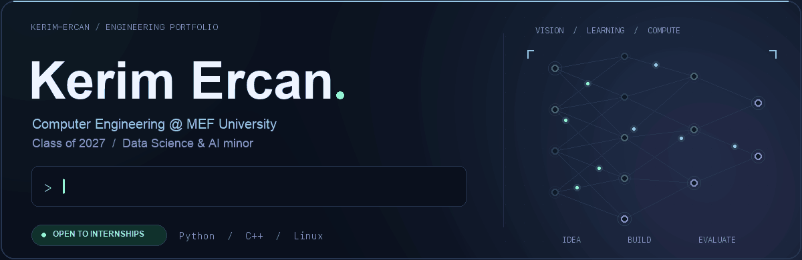

  

  <a href="https://www.linkedin.com/in/kerim-ercan"><strong>LinkedIn</strong></a>
  &nbsp; · &nbsp;
  <a href="https://github.com/Kerim-ercan?tab=repositories"><strong>Explore my repositories</strong></a>

## About me

I'm a fourth-year **Computer Engineering student at MEF University**, expecting to graduate in **2027**, with a minor in **Data Science and Artificial Intelligence**.

My projects connect **machine learning with working applications**: image and audio classification, live webcam inference, and automation across operating systems. I'm also developing my **C++ and parallel-computing** skills through OpenMP, containerized workloads and Slurm-based HPC experiments.

**I'm looking for internship opportunities in software engineering, computer vision and machine learning.**

## Selected projects

| Project | What I worked on | Technologies |
| --- | --- | --- |
| **[CIFAR-10 Image Classification](https://github.com/Kerim-ercan/cifar10-cnn-classification)** | Built, trained and evaluated the CNN in a team project. The recorded evaluation reached **~85% accuracy**, compared with **58.4%** for the team's MLP baseline. | Python · TensorFlow/Keras · scikit-learn |
| **[Emotion-Controlled Platformer](https://github.com/Kerim-ercan/emotion-controlled-platformer)** | Connected a **five-class facial-expression model** and live webcam input to game controls, with a keyboard fallback. | Python · OpenCV · Keras · Pygame |
| **[Environmental Audio Classification](https://github.com/Kerim-ercan/environmental-audio-classification)** | Iterated on a **10-class mel-spectrogram CNN**, using augmentation, class balancing and regularization. Recorded test accuracy improved from **45.1% to 70.7%**. | Python · TensorFlow/Keras · Librosa |
| **[Cross-Platform Monitor Control](https://github.com/Kerim-ercan/monitor-control)** | Created scripts that watch Bluetooth keyboard connections and request monitor input changes through DDC/CI, with setup guides for three operating systems. | Bash · PowerShell · macOS · Windows · Linux |
| **[LZW Text & Image Compression](https://github.com/Kerim-ercan/Image-Compression-using-LZW)** | Implemented dictionary-based compression for text, grayscale images and color images as a coursework project. | Algorithms · Data compression · Image processing |

## Technical toolkit

  

**Also used in my projects:** Keras · NumPy · pandas · scikit-learn · Librosa · Apptainer

Interested in my work or an internship opportunity? **[Let's connect on LinkedIn.](https://www.linkedin.com/in/kerim-ercan)**
